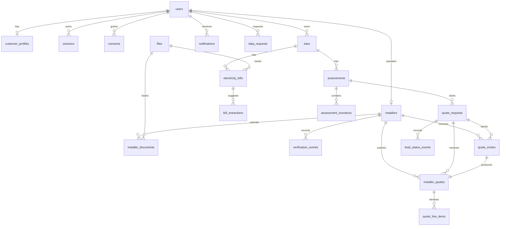

# Data Model — SOLARekta MVP

**Database:** SQLite 3 (WAL), schema in `db/schema.sql`  
**Access:** raw SQL through `better-sqlite3`; ownership checks in application code  
**Money:** REAL whole Philippine pesos for MVP readability. Production should use integer centavos
or PostgreSQL `numeric(14,2)`.

## 1. Entity groups

## 2. Tables

### Identity and access

| Table | Purpose | Key columns / constraints |
|---|---|---|
| `users` | All roles | `email UNIQUE`, `role CHECK(customer/installer/admin)`, `status CHECK(active/suspended)`, `password_hash` |
| `sessions` | DB-backed sessions | `id` = SHA-256(token), `user_id FK CASCADE`, `expires_at`, index on user |
| `customer_profiles` | Customer account metadata | `user_id PK/FK`, `account_type CHECK(homeowner/business)` |
| `consents` | Consent ledger | `kind CHECK(bill_processing/contact_sharing/marketing/terms/privacy)`, `version`, `granted_at`, `revoked_at`; index `(user_id, kind)` |
| `data_requests` | Export/deletion requests | `kind CHECK(export/deletion)`, `status CHECK(pending/processing/completed/rejected)`, resolver FK |

### Sites, bills and assessments

| Table | Purpose | Key columns / constraints |
|---|---|---|
| `sites` | Customer property | `user_id FK CASCADE`, city/roof/usage fields with CHECKs, `roof_area_m2 REAL`, budget; index on user |
| `electricity_bills` | Confirmed/draft bill | `site_id`/`user_id` FKs, `monthly_kwh`, `total_php`, lifecycle `CHECK(draft/confirmed)`, `source CHECK(manual/ai/ai_corrected)`, optional `file_id`; indexes on site/user |
| `bill_extractions` | AI extraction audit | `bill_id FK CASCADE`, provider/model, `raw_json`, `confidence`, `status CHECK(suggested/accepted/rejected/failed)` |
| `assessments` | Stored deterministic result | `site_id`/`user_id` FKs, `model_version`, `inputs_json`, `result_json`, `explanation`, `explanation_source`, `status CHECK(draft/ready/quote_requested/archived)`; indexes on user/site |
| `assessment_scenarios` | Queryable scenario summary | `assessment_id FK`, `name CHECK(low/base/high)`, capacity/production/savings/payback/capex/net25/self-consumption, `summary_json` |

Stored assessments are immutable snapshots. Changing assumptions requires a new `MODEL_VERSION`;
reads never recalculate historical rows.

### Marketplace

| Table | Purpose | Key columns / constraints |
|---|---|---|
| `installers` | Business profile | `user_id UNIQUE FK`, `slug UNIQUE`, `service_areas_json`, `verification_status CHECK(draft/pending/verified/rejected/suspended)`, `verified_at`, licence and experience; index on status |
| `installer_documents` | Private evidence | `installer_id`/`file_id` FKs, `kind CHECK(sec_registration/mayors_permit/licence/insurance/other)`, `status CHECK(pending/approved/rejected)`, reviewer FK |
| `verification_events` | Verification history | `installer_id FK`, actor FK, action, notes |
| `quote_requests` | Customer request | `customer_user_id`, `site_id`, `assessment_id` FKs, `status CHECK(open/matched/closed/cancelled)`, `share_contact INTEGER`, contact fields |
| `quote_invites` | Per-installer assignment | `quote_request_id`/`installer_id` FKs, `UNIQUE(request, installer)`, `status CHECK(invited/viewed/quoted/declined/withdrawn)`; index on installer/status |
| `installer_quotes` | Structured bid | `invite_id UNIQUE FK`, request/installer FKs, `status CHECK(submitted/revised/withdrawn)`, capacity/price/warranties/timeline/production |
| `quote_line_items` | Itemisation | `quote_id FK CASCADE`, description, amount; index on quote |
| `lead_status_events` | Lead timeline | request FK, actor user/role, from/to status, note |

### Files, notifications and audit

| Table | Purpose | Key columns / constraints |
|---|---|---|
| `files` | Private upload metadata | `owner_user_id FK`, `storage_key UNIQUE`, original name, MIME, bytes, SHA-256, purpose; index on owner |
| `notifications` | In-app inbox | `user_id FK`, kind/title/body/href, `read_at`; index `(user_id, read_at)` |
| `audit_events` | Append-only audit | actor user/role, action, entity type/id, `metadata_json`, IP, created_at; indexes on entity and time |

## 3. Ownership and isolation rules

| Data | Read rule | Write rule |
|---|---|---|
| Sites/bills/assessments | `user_id = session user` | Same predicate on update/delete |
| Quote requests | `customer_user_id = session user` | Same predicate; installer reads via invite join |
| Installer leads | `EXISTS invite(quote_request, installer of session)` | Invite must belong to installer; verified only |
| Installer profile/documents | Installer owns; admins review all | Installer owns; admin decisions via role guard |
| Files | Owner, or admin, or invited installer for non-bill installer docs | Uploader owns; deletion through owner/admin flow |
| Notifications | `user_id = session user` | System-generated only |
| Audit | Admin only | Append-only helper; never updated/deleted in app code |

Contact details are *additional* fields on `quote_requests` and are only rendered when
`share_contact = 1`; an installer must also be verified for the comparison helper to expose them.

## 4. Indexes

Existing indexes cover the access paths used by the MVP:

- sessions by user; files by owner; sites by user; bills by site and user.
- assessments by user and site; scenarios by assessment.
- installers by verification status; invites by `(installer_id, status)`.
- quotes by request; line items by quote; notifications by `(user_id, read_at)`.
- audit by `(entity_type, entity_id)` and `created_at`.
- consents by `(user_id, kind)`.

At pilot volume, admin list queries use sequential scans over small tables. Add pagination and
covering indexes before growth.

## 5. Data lifecycle and retention

| Data | Baseline behaviour | Production recommendation |
|---|---|---|
| Bills/uploads | Kept until bill/account deletion | Add a retention limit (for example 24 months) and scheduled purge |
| Assessments | Kept per site, archivable by customer | Retain while account active; export before deletion |
| Consent records | Kept as a ledger | Retain evidence of grant/withdrawal per policy |
| Audit events | Kept indefinitely in MVP | Define retention; preserve security-relevant events |
| Deletion request | Removes sites, bills, assessments, files, installer data; anonymises user; keeps audit | Add a job that also purges backups per policy |
| Sessions | Deleted on logout; expired rows remain until cleanup | Add periodic cleanup job |

The app currently has no scheduler. An admin completes deletion requests manually; uploads are
unlinked during that flow.

## 6. Migration plan to PostgreSQL

1. Translate CHECK constraints to PostgreSQL enums or check constraints; keep the same state names.
2. Convert `REAL` money to `numeric(14,2)` (or integer centavos) and update the engine adapters.
3. Replace `better-sqlite3` calls with a thin query layer (`pg` or Kysely); keep SQL explicit.
4. Add `uuid` types and `gen_random_uuid()` or continue app-generated IDs.
5. Move `inputs_json`/`result_json`/`summary_json` to `jsonb` with validation on write.
6. Move uploads to S3-compatible private storage and issue short-lived signed URLs.
7. Replace the in-memory limiter with Redis or a platform rate limiter.
8. Backfill from SQLite with a one-off script; reconcile row counts and foreign keys.
9. Run both systems read-only in parallel for a pilot cohort before cutover.
