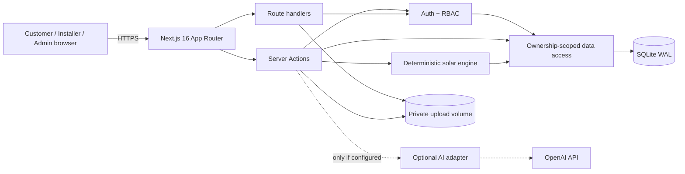
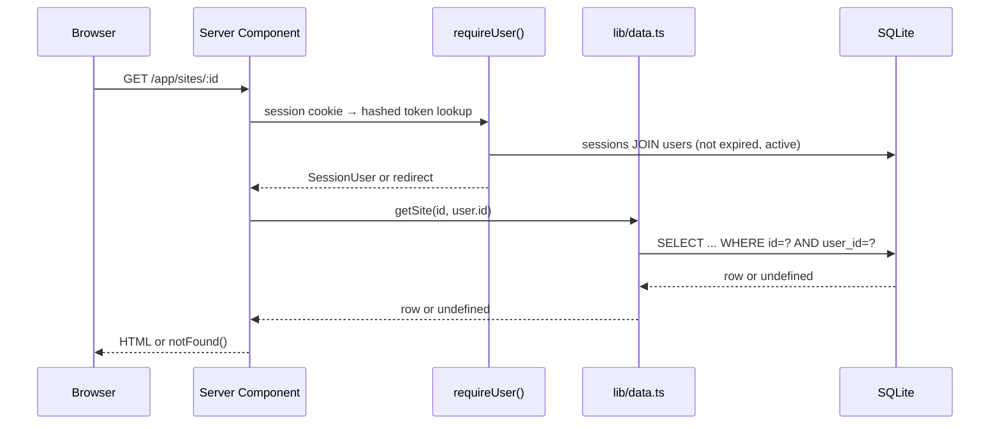
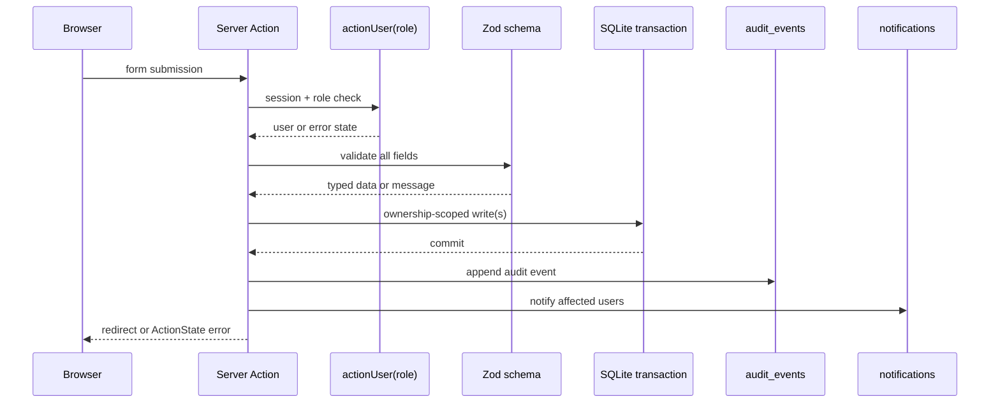

# System Architecture — SOLARekta MVP

## 1. Style

A **modular monolith** on Next.js 16 App Router. One Node process serves server-rendered React,
Server Actions and two route handlers. Business logic is grouped by domain under `lib/`; there is no
separate API service, message broker or microservice in the MVP.



## 2. Module map

| Module | Responsibility |
|---|---|
| `app/(marketing)` | Public pages, method, safety, installers directory, legal copy |
| `app/(auth)` | Login/signup pages and client forms |
| `app/app` | Customer dashboard, sites, bills, assessments, quotes, notifications, settings |
| `app/installer` | Onboarding, profile, leads and quote submission |
| `app/admin` | Verification, quote moderation, data requests, audit, funnel |
| `app/actions` | Server Actions grouped by domain; all mutations enter here |
| `app/api/files/[id]` | Authenticated private file streaming |
| `app/api/me/export` | Self-service JSON data export |
| `lib/auth.ts` | Sessions, role guards, cookie lifecycle, `safeNextPath` |
| `lib/passwords.ts` | Pure scrypt hash/verify helpers (seed + tests reuse) |
| `lib/data.ts` | Ownership-scoped reads used by pages/actions |
| `lib/solar/*` | Versioned assumptions, city yields and deterministic engine |
| `lib/quotes.ts` | Normalised quote metrics for comparison |
| `lib/ai/provider.ts` | Optional OpenAI extraction/explanation with validation |
| `lib/files.ts` | Magic-byte validation, private storage, safe path resolution |
| `lib/validation.ts` | Zod schemas and form helpers |
| `lib/audit.ts` | Append-only audit events and notification helper |
| `lib/db.ts` | SQLite connection, WAL, foreign keys and first-run schema |
| `db/schema.sql` | 21-table schema with checks, FKs and indexes |
| `scripts/db-setup.mjs` | Explicit database creation/reset |
| `scripts/seed.ts` | Synthetic demo data with valid PDF placeholders |

## 3. Request and data flows

### 3.1 Authenticated read



The ownership predicate is the security boundary. A valid session alone is never sufficient.

### 3.2 Mutation



### 3.3 Bill capture and AI boundary

1. Server Action checks the customer owns the site.
2. File bytes are checked against PDF/JPEG/PNG/WEBP signatures and the 8 MB cap.
3. Bytes are written under `var/uploads/YYYY-MM/<uuid>.<ext>` with a `files` row.
4. Only if AI is enabled and the customer ticks the box does the image go to the provider.
5. Provider JSON is validated by `aiExtractionSchema`; invalid output is discarded.
6. A draft bill is stored. The customer must review/confirm; confirmation records `ai_corrected`
   when an extraction existed.
7. PDFs are never sent to AI (image extraction only). AI is never given identity or file listings.

### 3.4 Assessment

1. Confirmed bill + site fields → `assessSolar()` pure function.
2. Engine validates ranges and computes three scenarios and 25 annual cashflows.
3. Result JSON, inputs JSON, model version and scenario summary rows are stored in one transaction.
4. Page renders the stored JSON; it does not recompute on read.
5. Explanation generation stores either an AI rewrite or the deterministic paragraph.

## 4. Security boundaries

| Boundary | Control |
|---|---|
| Browser → server | Session cookie; Server Actions; CSP; origin checks from Next |
| Customer ↔ customer | Ownership predicates in every query |
| Installer ↔ installer | Invite-based lead lookup; no global lead reads |
| Installer ↔ customer data | No bill file/full address; contact only when consent is on |
| Admin | Explicit `requireUser(["admin"])` / `actionUser(["admin"])` |
| File delivery | Session + owner/reviewer check; path traversal guard |
| Uploads | Magic bytes, 8 MB cap, private directory, random storage key |
| Secrets | Environment only; `.env*` ignored; never in client bundle |
| Audit | Append-only rows; sensitive metadata keys redacted |
| Rate limits | Signup, login, uploads (single-instance fixed window) |

### AI threat model

- **Prompt injection from bill text:** system prompt says the image is untrusted data; output is
  schema-validated and never executed as instructions.
- **Fabricated values:** AI only proposes extraction fields; the customer confirms. The engine never
  reads AI output.
- **Data minimisation:** no name, email, phone, address or installer documents are sent.
- **Failure:** timeouts/HTTP errors invalid-schema responses fall back to manual entry or the
  deterministic explanation.
- **No tool use:** the adapter has no tools, payments, file access or verification authority.

## 5. Deployment topology (pilot)

```
Internet → HTTPS reverse proxy / platform TLS
        → Node process (`next start`)
        → SQLite file + WAL on a persistent volume
        → private upload volume
        → optional outbound OpenAI API
```

Single instance only. `NODE_ENV=production` makes cookies `secure`.

## 6. Reliability and recovery

- SQLite WAL with `busy_timeout=5000` and foreign keys on.
- Nightly file-level backup of the database (including WAL checkpoint) and upload volume.
- Restore = stop app, restore DB + uploads, start app, verify `/login` and a known account.
- `npm run db:reset` is destructive and demo-only; never point it at production data.
- Idempotent seed replaces only the five known demo emails.
- Assessments store their model version and JSON, so formula changes do not rewrite history.

## 7. Scaling path

1. **First:** move to PostgreSQL and S3-compatible private object storage; add shared rate limiting.
2. Add background jobs for email, malware scanning, retention and quote expiry.
3. Split file streaming to signed object URLs.
4. Add observability (structured logs, error tracking, metrics).
5. Only then consider service extraction; the domain modules already have clear seams.

## 8. Deliberate omissions

No cache layer, message queue, websocket, search cluster, feature-flag service, payment provider or
third-party analytics. Each would add operational cost without proving the pilot hypothesis.
